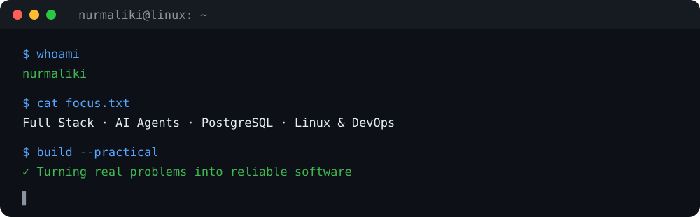
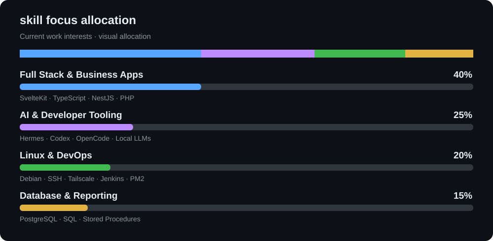

<div align="center">

# Hi, I'm Nurmaliki 👋

**Full Stack Software Developer · AI Agent Enthusiast · Linux & DevOps**

Building practical business applications, developer tooling, and reliable self-hosted systems.

[](https://github.com/Nurmaliki)

</div>



## About me

I'm an Indonesia-based software developer focused on solving real operational problems through maintainable web applications, database systems, automation, and AI-assisted development.

- 💻 Develop full-stack business applications with **SvelteKit, TypeScript, NestJS, Node.js, and PHP / CodeIgniter**.
- 🗄️ Work with **PostgreSQL**, SQL queries, stored procedures, reporting, and data validation.
- 🤖 Explore **Hermes Agent, Codex, OpenCode, Ollama, Qwen**, and OpenAI-compatible model integrations.
- 🐧 Manage Linux-based development and deployment workflows using **Debian, SSH, Tailscale, PM2, Jenkins, and Git**.
- 🧩 Interested in ERP, cooperative finance, HR & payroll, KPI management, clinic systems, and Indonesian tax software.

## Skills & focus



> The percentages above illustrate my current areas of focus, not a formal proficiency assessment.

### Technologies I work with

**Frontend**


**Backend & databases**


**Infrastructure & development tools**


## What I build

| Area | Work & interests |
| --- | --- |
| 🏢 Enterprise & business apps | ERP modules, cooperative financial reporting, HR/payroll, KPI workflows |
| 🏥 Operational systems | Clinic management and workflow-focused web applications |
| 📊 Database & reporting | PostgreSQL queries, stored procedures, GL reports, JasperReports |
| 🤖 AI-assisted development | Local/cloud LLM routing, coding agents, development automation |
| 🛠️ Infrastructure | Linux servers, secure remote access, CI/CD, process management |
| 🌱 Product experiments | Offline-first web apps, browser storage, and interactive web games |

## My development approach

```text
Understand the problem
       ↓
Design a maintainable solution
       ↓
Build & integrate
       ↓
Test, review & secure
       ↓
Deploy, observe & improve
```

## GitHub activity

<div align="center">


</div>

> GitHub statistics are provided by a third-party service and may occasionally be unavailable. Language statistics reflect repository contents, not overall expertise.

## Current interests

- Building practical AI agent workflows for software engineering.
- Improving deployment and self-hosted infrastructure on lightweight Linux servers.
- Creating reliable, user-friendly enterprise applications.
- Exploring offline-first applications and local-first storage.

---

<div align="center">

**Build useful software. Automate repetitive work. Keep systems maintainable.**

[GitHub Profile](https://github.com/Nurmaliki)

</div>
